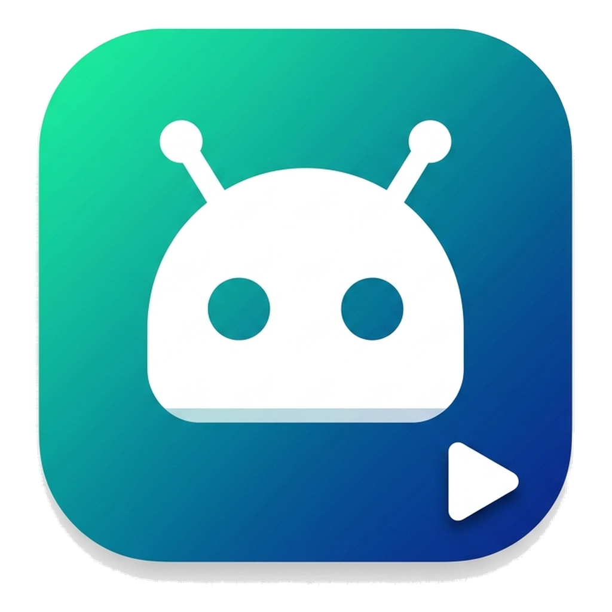

<p align="center">
  
</p>

# SimpleDroid

A minimal, bloat-free Windows 11 desktop app player that wraps the official Android SDK Emulator and `adb` behind a clean, BlueStacks-inspired PySide6 GUI.

> **Quick Download:** Grab the standalone `SimpleDroid.exe` from the [Releases](../../releases) tab — no Python setup required.

---

## Features
- **Automated First-Run Setup**
  - Checks Windows Hypervisor Platform (WHPX) / Hyper-V and opens `optionalfeatures.exe` if virtualization needs to be enabled.
  - Reuses any existing Android SDK (`%LOCALAPPDATA%\Android\Sdk`, `%ANDROID_HOME%`, etc.) and JDK 17+ on your PC, or automatically downloads official Google SDK tools and portable Eclipse Temurin JDK 17 into `%LOCALAPPDATA%\SimpleDroid`.
  - Installs only missing SDK components and creates the `SimpleDroid` virtual device (`Android 15` by default, with options for `Android 14`, `Android 16`, `Android 17`, and `Android 11`).
- **BlueStacks-Style App Player**
  - Top bar with **Start Android / Stop Android**, live **Stopped / Booting / Ready** status (`sys.boot_completed`), and Android version badge.
  - Drag-and-drop or double-click `.apk` files to install (`adb install -r -t`) with real `adb` error reporting; automatically starts Android if stopped.
  - Home screen **`+ Add to Phone`** tile and **Phone Files** tab to transfer photos, videos, documents, and ZIPs directly to/from `/sdcard/Download`.
  - Searchable **My Apps & Games** card grid with **Launch** (`monkey` / `am start`) and **Uninstall** actions.
  - Right-side device control toolbar: **Home**, **Back**, **Recent**, **Vol +**, **Vol -**, **Rotate**, and **Snap** (screenshot).
- **Low-End Hardware Compatibility & Stability**
  - Automatically tunes default RAM and CPU cores to match your host PC, plus a 1-click **Optimize for Low-End PC** preset (`540p` / `720p`, `2 GB` RAM, `-no-boot-anim`, `-no-metrics`, `0` animation scale).
  - Suppresses blank console popups (`CREATE_NO_WINDOW`), cleans stale `.lock` files, recovers from broken snapshots/GPU drivers, and captures logs to `%LOCALAPPDATA%\SimpleDroid\logs\emulator.log`.

---

## Requirements
- **Windows 11 (x64)** with hardware virtualization enabled in BIOS/UEFI and **Windows Hypervisor Platform** enabled (`optionalfeatures.exe`).
- **Internet access** on first run if Android SDK components or portable JDK 17 need to be downloaded.
- For running from source: **Python 3.11+** and `PySide6`.

---

## Running from Source

```powershell
python -m venv .venv
.\.venv\Scripts\Activate.ps1
pip install PySide6 pyinstaller
python main.py
```

## Building a Standalone Windows `.exe`

```powershell
pyinstaller --onefile --windowed --name SimpleDroid --icon=assets/icon.ico --add-data "assets/icon.ico;assets" --add-data "assets/icon.png;assets" --exclude-module PySide6.QtWebEngineWidgets --exclude-module PySide6.QtWebEngineCore --exclude-module PySide6.QtWebEngineQuick --exclude-module PySide6.QtPdf --exclude-module PySide6.QtPdfWidgets --exclude-module PySide6.Qt3DCore --exclude-module PySide6.Qt3DRender --exclude-module PySide6.QtQuick --exclude-module PySide6.QtQml --exclude-module PySide6.QtMultimedia --exclude-module PySide6.QtNetwork --distpath . main.py
```

---

## Project Structure
- `main.py` — Entry point, taskbar icon, pure-Python localhost IPC, and HKCU `.apk` file association.
- `ui.py` — BlueStacks-inspired PySide6 GUI and daemon-thread signal bridge.
- `sdk_manager.py` — WHPX check, SDK/JDK discovery, duplicate cleanup, downloads, and AVD setup.
- `emulator.py` — Emulator process management, crash recovery, quick-boot snapshots, log capture, and clean shutdown.
- `adb_tools.py` — `adb` wrappers (`install`, `pm list`, `monkey`, `uninstall`, file transfer, keyevents, screenshot, `emu kill`).
- `config.py` — Host-aware defaults, presets, asset helpers, and `%LOCALAPPDATA%\SimpleDroid\config.json` persistence.
- `assets/icon.ico`, `assets/icon.png` — Application and `.apk` file icons.
